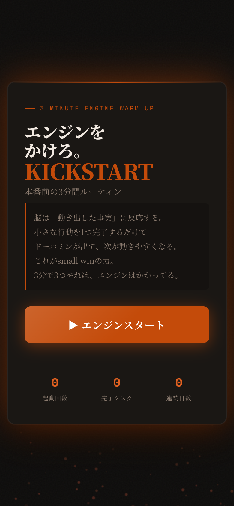
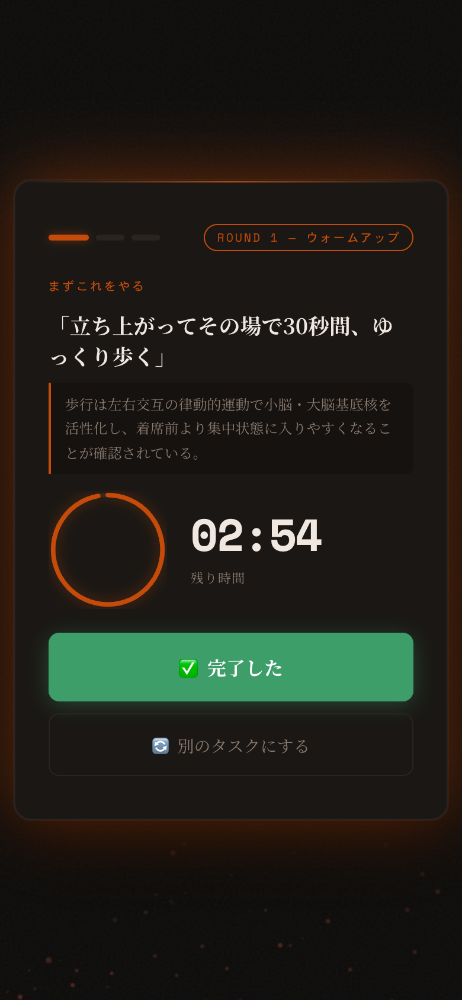
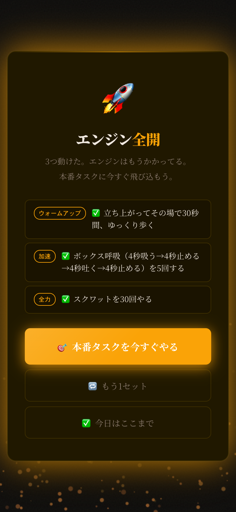

# KICKSTART — 3分間エンジンウォームアップ

仕事や勉強を始めようとしているのに、なかなか最初の一歩が踏み出せない人向けのアプリ。

「水を飲む」「スクワットをする」「深呼吸する」など、頭を使わずにできる小さな行動を3つこなすことで、作業に入りやすい状態を作る。1タスク1分、合計3分。

## スクリーンショット

| スタート画面 | タスク画面 | 完了画面 |
|---|---|---|
|  |  |  |
| 「エンジンスタート」で開始。起動回数・完了タスク数・連続日数を表示する | ラウンドごとのタスクと根拠を表示。円形タイマーで残り時間がわかる | こなした3つのタスクを振り返り、本番タスクへ送り出す |

## 使い方

1. 「エンジンスタート」を押す
2. 表示されたタスクを1分以内にこなす
3. 「完了した」を押して次へ
4. 3つ終わったら本番タスクに飛び込む

## 3つのラウンド

| ラウンド | テーマ | 内容 |
|---|---|---|
| ROUND 1 ウォームアップ | 体・感覚を起こす | 水を飲む、スクワット、呼吸法、冷水など約1分の軽い行動 |
| ROUND 2 加速 | 体をもっと動かす＋思考の言語化 | 回数を増やした運動＋気分・モヤモヤをメモに書き出す |
| ROUND 3 全力 | 体の限界近く＋行動の具体化 | バーピー・プランクなど高強度運動＋本命タスクの最初の一手を書く |

各タスクには科学的根拠（エビデンス）の短い説明が表示される。

## 技術スタック

- 素のHTML / CSS / JavaScript（依存ライブラリなし）
- localStorage で起動回数・完了タスク数・連続日数を保存
- Canvas APIで炎パーティクルアニメーション

## ローカルで開く

```
open index.html
```

依存関係なし。ファイルをブラウザで直接開くだけで動く。
